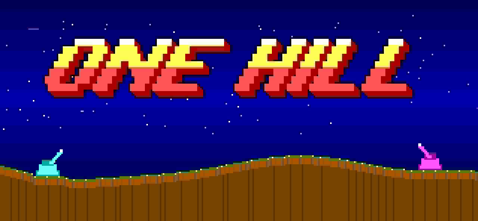
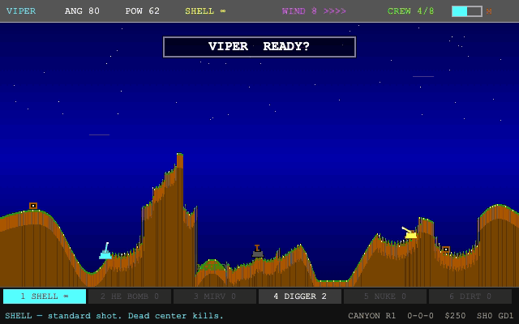
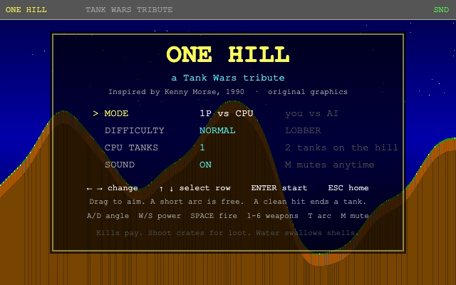
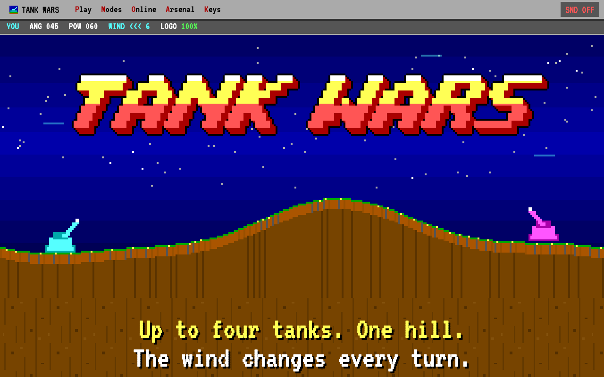
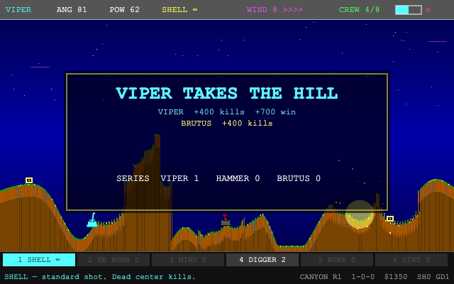
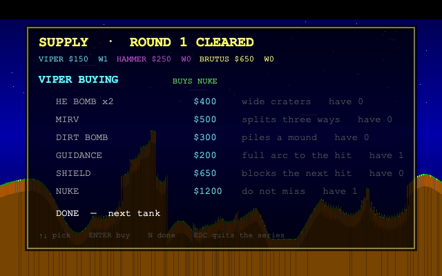
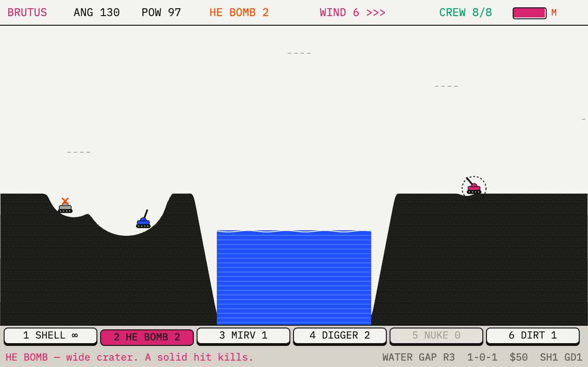
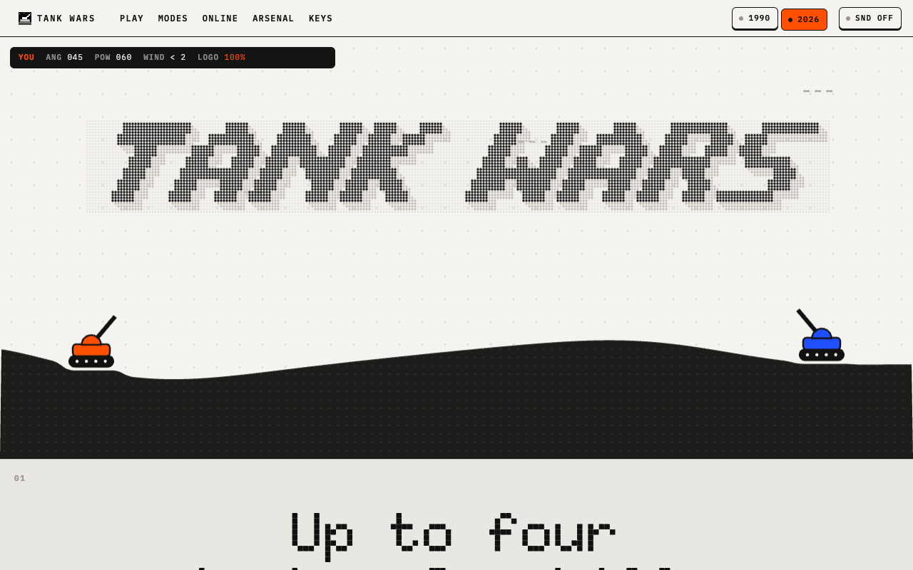

# One Hill

*A Tank Wars tribute.*

<p align="center">
  
</p>

<p align="center"><b>Up to four tanks. One hill. The wind changes every turn.</b></p>

Remember the family 386? The fan noise, the beige box, sixteen glorious colors, and a little tank parked on a brown hill. You nudged the barrel up a few degrees, cranked the power, held your breath, and fired. The shell sailed over the mountain, caught a gust you forgot about, and landed squarely on your own head.

**One Hill** brings that afternoon back, in your browser. It's a tribute to Kenny Morse's 1990 MS-DOS shareware classic *Tank Wars* / *Tank Wars 2.5*: VGA palette, turn-based shots, wind, and craters that stay where you dug them. It isn't a pixel-perfect clone, and it definitely isn't a 3D remake. No install, no account, no DOSBox.

```text
C:\> CD ONEHILL
C:\ONEHILL> ONEHILL.EXE
Bad command or file name.   (It runs in your browser now. Open index.html.)
```

What's on the hill:

- **Terrain you can wreck.** Every hill is a new canyon, mesa, or water gap. Blow the dirt out from under a tank and down it goes.
- **Wind with a grudge.** It changes every turn, sometimes completely. The shot that worked last time is lying to you now.
- **A shop between hills.** Spend your kill money on HE bombs, MIRVs, dirt bombs, shields, guidance, and a $1200 nuke labeled *do not miss*. Or get them free: shoot the loot crates that drop mid-battle.
- **CPU rivals with attitude.** *Rookie*, *Lobber*, and *Windmaster* take you on one at a time. Add more and *Viper*, *Hammer*, and *Brutus* go free-for-all, shooting whoever is closest, including each other.
- **A new hill every day.** The Daily Hill gives everyone the same map, wind and bonus kit against LOBBER. Take it in as few shots as you can, then post your row of shots.
- **Couch warfare.** Hotseat for 2–4 people on one keyboard, with a `LOOK AWAY` screen so nobody peeks at your aim.
- **Online with a five-letter code.** Send a friend `K7Q4M` and you're on the same hill, peer-to-peer, with no server to run.
- **Bragging rights.** Finish a series and the game hands you a result card of the final blow, ready to post.
- **Bleeps and booms.** Every sound is synthesized live in the browser with Web Audio oscillators and noise.
- **1990 or 2026.** Flip the switch in the menu bar and the whole thing, front page and game, jumps 36 years: dot-matrix type, warm-gray hardware, black ink, one signal orange, and rounder synth sounds. Same hill, same physics, same opponents.

All graphics and sounds are original. Nothing was copied from the DOS binaries.

## Screenshots

<p align="center">
  
  <br />
  <sub>Attract mode, three CPU tanks on HARD: a kill shot, the hill taken, a quick shopping trip, and then somebody buys the nuke.</sub>
</p>

<table>
  <tr>
    <td width="50%"></td>
    <td width="50%"></td>
  </tr>
  <tr>
    <td align="center"><sub>The title screen. Pick a mode, pick a fight.</sub></td>
    <td align="center"><sub>The front page. Yes, you can shoot the logo.</sub></td>
  </tr>
  <tr>
    <td width="50%"></td>
    <td width="50%"></td>
  </tr>
  <tr>
    <td align="center"><sub>Last tank standing takes the hill, and the payout.</sub></td>
    <td align="center"><sub>Between hills, everybody goes shopping.</sub></td>
  </tr>
  <tr>
    <td width="50%"></td>
    <td width="50%"></td>
  </tr>
  <tr>
    <td align="center"><sub>2026 mode. Same water gap, rebuilt as hardware.</sub></td>
    <td align="center"><sub>The 2026 front page. The logo is a dot-matrix display now, and you can still shoot it.</sub></td>
  </tr>
</table>

## Run it

Open `index.html` (the front page) or `play.html` (straight into the game) in a browser, or serve the folder:

```bash
python3 -m http.server 43721
```

Then visit `http://127.0.0.1:43721/`. No build step, no backend. Online play needs an internet connection (see below); everything else runs offline.

## 1990 / 2026

The **1990 · 2026** keys in the menu bar (on the front page and above the game) switch eras:

| | 1990 | 2026 |
| --- | --- | --- |
| Look | VGA palette, chunky pixels, text-mode windows | Warm-gray hardware, black ink, signal orange, dot-matrix display type |
| Game screen | Blocky 640×400, scaled up | The same 640×400 field drawn sharp at your screen's resolution |
| Sound | Square and sawtooth beeps | Sine and triangle tones, deeper booms, a short echo |

The choice is remembered, other open tabs follow along, and a link with `?era=2026` (or `?era=1990`) opens in that era. Only the drawing and the sounds change, so an online match works with players in different eras.

## Front page

`index.html` is a landing page built as a cross-section of the battlefield: a night sky and hill on top, then one soil layer per section down to bedrock, with the content in DOS-style text-mode windows.

- The hero is playable. Click or tap anywhere (or focus it and press Enter) to lob a shell at the logo. Go quiet and the CPU tank shoots it instead. The logo rebuilds itself a pixel at a time.
- The beige monitor runs the real game in attract mode (`play.html?demo`: three CPU tanks on HARD, muted). It only loads while it is on screen. With reduced motion turned on, a still frame (`img/demo.png`) is shown instead.
- The setup dialog, the invite-code box, and the blast-radius chart all link into the game. Keycaps on the page press down when you press the real key.
- Sound is off until the **SND** button in the menu bar turns it on.

Links that work on `play.html`:

| URL | Opens |
| --- | --- |
| `play.html?mode=cpu` / `daily` / `hotseat` / `online` | the title screen with that mode picked |
| `play.html?host` | a new online room straight away |
| `play.html?room=K7Q4M` | the join screen, already dialling that room |
| `play.html?demo` | attract mode, CPU vs CPU |

A `?room=` link that lands on `index.html` is forwarded to the game.

## Modes (title screen)

A match is a **best of 5**: first tank to **3 hill wins** takes the series (or the leader after five hills). The Daily Hill is the exception: one hill, one try.

| Setting | Options |
| --- | --- |
| **MODE** | **1P vs CPU** — you against 1–3 AI tanks · **DAILY HILL** — today's hill, the same for everyone · **HOTSEAT** — 2–4 humans, same keyboard · **ONLINE** — 2–4 players on their own screens |
| **DIFFICULTY** | (vs CPU) Easy / Normal / Hard — a lone AI is named *Rookie*, *Lobber*, or *Windmaster* |
| **CPU TANKS** | (vs CPU) 1, 2, or 3. With more than one it is a free-for-all: *Viper*, *Hammer*, and *Brutus* shoot whoever is closest, including each other |
| **PLAYERS** | (hotseat) 2, 3, or 4 |
| **ROOM** | (online) **HOST** opens a room and shows an invite code · **JOIN** asks for a friend's code |
| **SOUND** | On / Off |

**← →** change the highlighted value · **↑ ↓** move between rows · **Enter** or **click** to start · **Esc** back to the front page.

The game fills the browser window. The bar above it has **◄ EXIT TO HOME** and a **FULL SCREEN** button (hidden on iPhone, which can't do full screen for a page).

Hotseat opens on `P1 — LOOK AWAY` before the hill is shown, then blanks again before every later human turn. Press **Enter** when the keyboard has been passed.

## Daily Hill

One hill a day, the same for everyone. Pick **DAILY HILL** on the title screen, or open `play.html?mode=daily`.

- **Same for everyone.** The map, the tank positions, the wind on every turn, the crates and LOBBER's aim all come from random numbers seeded by the date. Two players who fire the same shots see the same game. The day turns over at midnight on your own clock, and Daily Hill #1 was 1 November 2026.
- **One kit a day.** There's no shop. You get the usual starting ammo plus the day's bonus (a nuke, a MIRV, two HE bombs, two guidance charges, a shield or two dirt bombs). LOBBER gets no bonus.
- **Fewest shots wins.** Each of your shots is marked when it settles: ⬛ miss, ⬜ close, 🟨 hit, 💥 kill. Take the hill and your score is the number of shots.
- **Your first try counts.** The run is saved the moment you fire. Leave after that (ESC, reload, close the tab) and it counts as a loss. Leaving before you fire costs nothing.
- **Replays are practice.** After today's result is in, the hill can be replayed, but the score stays.
- **Share it.** The result opens the share dialog with a card of the final blow and a text you can paste anywhere:

  ```text
  One Hill · Daily Hill #1
  ⬛⬜🟨💥
  Taken in 4 shots · streak 3
  https://onehill.app/play.html?mode=daily
  ```

  **COPY TEXT** copies it. Your record (played, won, current streak, best streak) is kept in this browser's local storage and nowhere else.

## Online play

1. One player picks **ONLINE → HOST**. The room screen shows a five-letter **invite code** (no I, O, 0 or 1, so it is easy to read out).
2. Friends either open the **invite link** (`…/play.html?room=K7Q4M`, copied with **C** or the **COPY LINK** button; phones get the share sheet) or pick **ONLINE → JOIN** and type the code. Pasting the code or the whole link works too.
3. The host can fill empty seats with **CPU TANKS** (and pick their difficulty), then presses **Enter** / **START**. Up to four tanks in total.

How it plays:

- Each player aims on their own screen. Everyone else watches the barrel swing live and sees the same shell, crater, and wind.
- Your tank wears a **YOU** tag. The top-right corner shows `YOUR SHOT 0:45` or `P2 AIMING 0:31`.
- Every turn has a **45-second shot clock**. When it runs out your current aim fires. If a player goes silent, the host fires their last aim shortly after.
- Between hills everyone shops at the same time. The next hill starts when all players press **DONE**.
- If a guest leaves, a bot takes over their tank (`P2-BOT`) and the series carries on. If the host leaves, the series ends for everyone. **Esc** leaves the room.
- A room cannot be joined once the series has started.

How it works: the browsers connect peer-to-peer over WebRTC using [PeerJS](https://peerjs.com/), which is loaded from a CDN only when you pick ONLINE. The free PeerJS cloud broker introduces the players; after that, game data goes directly between browsers (or through PeerJS's public relay when a strict NAT blocks a direct link). The host owns every random roll (maps, wind, crates, CPU aim) and sends a snapshot at the start of each turn. Shots travel as angle, power, and weapon. Every screen flies them itself on the same fixed 1/120 s step, so all screens see the same result, and the next snapshot corrects any rounding drift.

To run your own broker instead of the public one (for example if it is down, or you are on a LAN):

```bash
npx peer --port 9000
```

Then open the game with `?broker=your.host:9000` (use `https://…` for a TLS broker). Invite links carry the setting along.

## Sharing a result

(The Daily Hill shares its own way; see above.) When a series ends, the game builds a result card: a 1200×675 PNG of the final blow of the last hill, with who took the series, the score, and every tank's hills, kills, damage, and shots. A dialog opens a moment later:

- **SHARE…** hands the picture itself to any app (Instagram, WhatsApp, Messages, X…). It appears on phones and on browsers that can share files.
- **SAVE IMAGE** and **COPY IMAGE** for desktops.
- **POST TO X / FACEBOOK / WHATSAPP / REDDIT** opens a ready-made post with the text and a link to the front page. Those links can't attach the picture, so save or copy it first.

The card and text are told from each screen's player ("I won a One Hill series 3-1 against WINDMASTER…", "P2 beat me 3-0…"); online, everyone gets their own. **Esc** closes it; **S** or the **SHARE RESULT** button on the result panel brings it back.

## Battle controls

Each hill is a new map: **canyon**, **mesa**, or a **water gap** (shells that hit the lake sink). Tanks drop in, then you aim and fire through the wind.

**Mouse:** drag around your tank to set the angle, drag up or down to set power, click to fire. A short arc is always drawn so you can see the shot leave the barrel. **T** extends it all the way to the landing, and that spends one guidance charge. Click a weapon on the bottom strip to select it. Click during a CPU turn to skip to the shot.

A centered hit kills. A graze takes a chunk and prints the damage. An HE bomb on the hull ends the tank. Shots fly quickly, and the next turn starts as soon as the shell lands.

| Key | Action |
| --- | --- |
| **A / D** or **← →** | Swing the muzzle. Left aims left (the angle number rises; 0° is flat right, 180° is flat left). A tap steps it; hold to sweep |
| **W / S** or **↑ ↓** | Shot power. A tap steps by 4; hold to sweep |
| **Shift** | Nudge angle/power more slowly |
| **1–6** or **click a weapon button** | Choose weapon. The bottom bar names each one and describes the one you picked |
| **[ ]** | Cycle weapons that still have ammo |
| **Space** or **Enter** | Fire. During a CPU turn, skip straight to the shot |
| **T** | Toggle the dotted arc while you have guidance. Firing with it on spends one charge. With none left, the banner says NO GUIDANCE |
| **M** | Mute / unmute all sound |
| **Esc** | Back to the title (ends the series). In full screen, the first Esc only leaves full screen |

A **READY?** banner flashes on each turn. A near miss prints **CLOSE!** and a shield prints **BLOCKED**. Wind is in the top bar (`<<<` west, `>>>` east). It changes every turn, sometimes completely, so an aim that hit last time usually needs adjusting. A big change flashes **WIND SHIFT**. Explosions bite craters; tanks fall if the dirt under them disappears. The bottom strip shows the map, series score, cash, shields, and guidance.

### Loot crates

Every few turns, and after every kill, a blinking supply crate drops onto the hill. Tanks can't drive, so you claim a crate by **shooting it**. Hit it, or land a blast close enough to catch it, and its rounds go to whoever fired, with a green **+NUKE** (or whatever was inside) over the spot. Anyone can take it, CPU tanks included.

| Crate | You get |
| --- | --- |
| BOMB | 2 HE bombs |
| MIRV | 1 MIRV |
| DIGGER | 1 digger |
| DIRT | 1 dirt bomb |
| NUKE | 1 nuke |

Bigger weapons catch crates from farther away: a shell has to land within about 20 px, an HE bomb about 34, a nuke about 52.

### Shop

Between hills, each tank spends cash. A hill win pays **$700**, a kill **$400**, surviving without the win **$150**. You start with **$250**.

| Item | Cost | What it does |
| --- | --- | --- |
| HE BOMB x2 | $400 | Wider craters |
| MIRV | $500 | Splits into three warheads |
| DIRT BOMB | $300 | Builds a mound where it lands |
| GUIDANCE | $200 | One dotted trajectory |
| SHIELD | $650 | Blocks the next hit, including a fall |
| NUKE | $1200 | Huge blast |

**↑ ↓** pick, **Enter** buy, **N** finished, or click a row. CPU tanks buy on their own. Ammo you do not fire carries to the next hill, and so does anything you won from a crate.

### Weapons

1. **SHELL** — standard HE, unlimited
2. **HE** — fat crater
3. **MIRV** — splits on the way down
4. **DIG** — burrows, then blows
5. **NUKE** — shop or crate
6. **DIRT** — piles dirt instead of digging it

Crew (top-right) is health. Damaged tanks cannot crank the cannon as hard.

### Sound

All SFX are synthesized (no audio files): fire, explosion, hit, death, splash, UI ticks while you adjust aim, crate and shop pickups, a light wind whoosh, and a win or lose jingle. In 2026 the same events play rounder sine and triangle tones through a short echo.

- **M** during play, or the **SOUND** row on the title screen
- HUD shows **MUTE** / **SND**

## Publishing

Everything is static: upload the folder to any host that serves HTTPS (GitHub Pages, Netlify, Cloudflare Pages…). There's no build step.

The search and sharing tags assume the site lives at **https://onehill.app/**. If it goes somewhere else, replace that address in `index.html` and `play.html` (canonical link, `og:url`, `og:image`, and the JSON-LD block on the front page), `sitemap.xml` and `robots.txt`. Then submit the sitemap in Google Search Console and Bing Webmaster Tools.

## Project layout

```
index.html      front page
js/era.js       the 1990 / 2026 switch, shared by both pages
landing.css     front page styles (VGA palette, soil layers, text-mode windows; 2026 section at the end)
js/landing.js   front page toys (shootable logo, attract monitor, join box, blast chart)
play.html       the game page
styles.css      game page: menu bar, monitor bezel, pixel scaling, 2026 section at the end
js/net.js       online transport (PeerJS loader, invite codes, peer links)
js/game.js      the whole game (palette, terrain, weapons, shop, AI, audio, HUD, online protocol)
favicon.svg     pixel tank icon (favicon.ico and img/icon-*.png are the same tank as PNGs)
robots.txt      lets every crawler in and points to the sitemap
sitemap.xml     the two pages, for search engines
site.webmanifest  name, colors and icons for "add to home screen"
og-image.png    the 1200×630 preview shown when a link is shared
img/demo.png    a real frame from the game, used when motion is reduced (img/demo-2026.jpg in 2026)
img/readme/     screenshots and GIFs for this README, recorded from the real game
fonts/          VT323 for 1990; Doto and IBM Plex Mono for 2026 (all SIL Open Font License, see the *-OFL.txt files)
```

Add a weapon by appending to the `WEAPONS` array in `js/game.js` and, if it needs special flight, a new `kind` in `stepShots`. Shop entries live in the `SHOP` array.

## Credit

One Hill is a tribute to *Tank Wars* (1990) by Kenny Morse. It's an independent fan project, not the original shareware program and not affiliated with it. All graphics, sounds and code are original.

Made by [culi.app](https://culi.app) and [Claude](https://claude.com/claude-code). Claude recorded every GIF on this page and fired a few dozen test shells at the logo along the way. It has yet to land a single one on the WARS half. Blame the wind.
